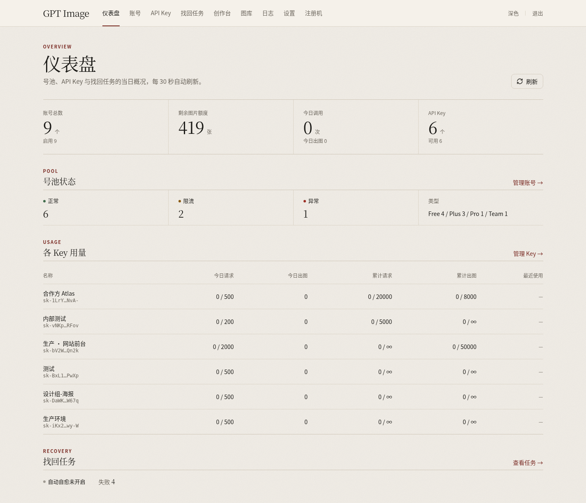
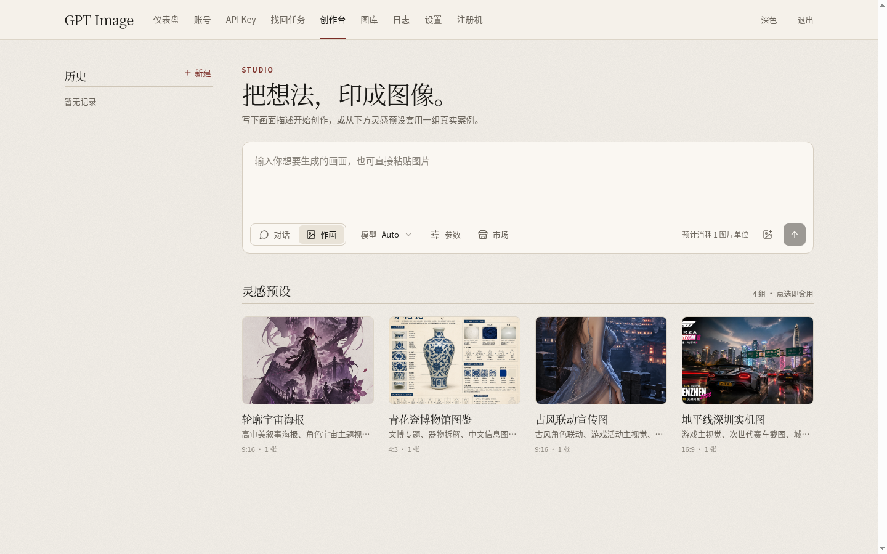
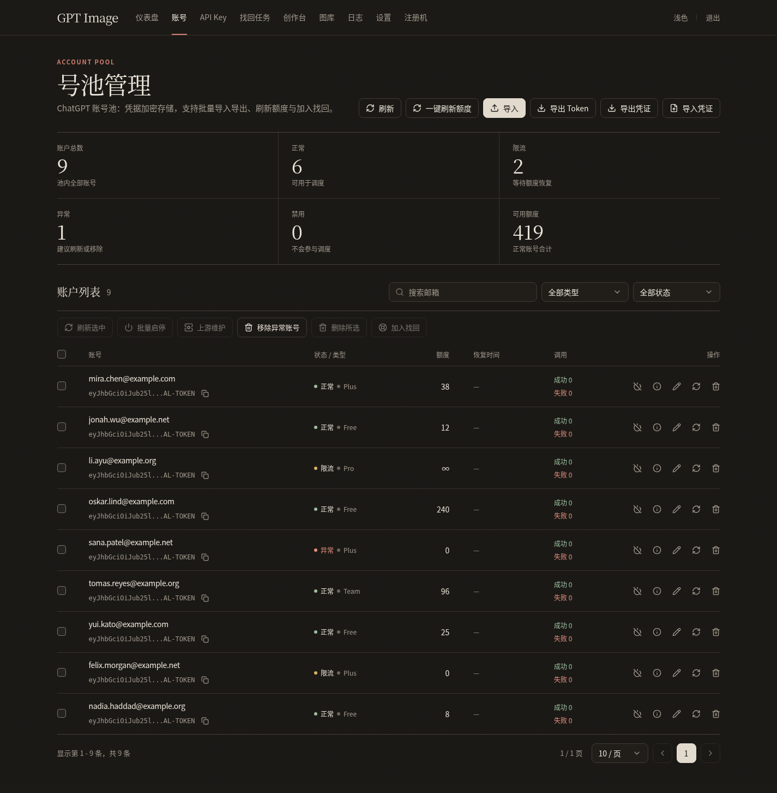

<h1 align="center">GPT Image</h1>

<p align="center">
  自托管的 ChatGPT 网页能力封装服务（基于 chatgpt2api）：OpenAI 兼容图片 API、在线创作台、账号池调度、独立 API Key、账号找回与自愈。单管理员使用。
</p>

> [!WARNING]
> 本项目涉及对 ChatGPT 官网接口的逆向研究，仅供个人学习与技术研究，严禁商业用途、批量滥用或任何违反 OpenAI 服务条款与当地法律的用途。账号受限、封禁、数据损失与法律责任由使用者自行承担。

> [!CAUTION]
> 公网部署请务必加外部访问控制，不要暴露管理端、账号 Token 或数据库连接串。

## 功能

- **OpenAI 兼容接口**：`/v1/images/generations`、`/v1/images/edits`、`/v1/chat/completions`、`/v1/responses`、`/v1/messages`、`/v1/models`，另有异步创作任务 `/api/creation-tasks/*`。
- **图像模型**：`gpt-image-2.6` / `-flare` / `-sunburst`（旧名 `gpt-image-2`、`gpt-image-2.5*`、`codex-gpt-image-2` 作为别名保留），映射表在 `internal/util/image_catalog.go`，驱动模型可在设置中修改。
- **独立 API Key**：名称、自定义或自动生成、启用/过期、总/每日请求与图片数上限、RPM、并发、模型白名单、用量统计；只存哈希。
- **账号池**：批量导入导出、额度刷新、限流/异常自动处理；账号详情可查看编辑凭证、读取邮件验证码、刷新 Token、密码或验证码重登。
- **找回任务与自愈**：持久化后台队列（重启续跑），刷新 Token → 密码登录 → 邮箱验证码登录自动收码 → 待填码批量提交；收码按域名路由 cloudflare_temp_email / outlookEmail / GPTMail。
- **安全**：账号密码与 `mail_token` 使用 AES-256-GCM 静态加密；设置接口对敏感字段返回掩码。
- **管理端**：杂志风顶部导航，浅色/深色主题；仪表盘、账号、API Key、找回任务、创作台、图库、日志、设置、注册机。

## 快速开始

```bash
git clone https://github.com/Sakuralaaa/GPT-Image.git
cd GPT-Image
cp .env.example .env    # 至少设置管理员密码和 CHATGPT2API_SECRET_KEY
docker compose -f deploy/docker-compose.yml up -d
```

默认镜像 `ghcr.io/sakuralaaa/gpt-image:latest`，端口 `3000 -> 80`，数据目录 `./data`。访问 `http://localhost:3000`。

未设置 `CHATGPT2API_ADMIN_PASSWORD` 时，首次启动会生成一次性密码：

```bash
docker compose -f deploy/docker-compose.yml logs app | grep "bootstrap admin password generated"
```

升级：

```bash
docker compose -f deploy/docker-compose.yml pull && docker compose -f deploy/docker-compose.yml up -d
```

可用镜像标签：`latest`、`<版本号>`（如 `1.0.1`）、`<主>.<次>`（如 `1.0`），见 [Releases](https://github.com/Sakuralaaa/GPT-Image/releases)。

## 环境变量

完整列表见 [`.env.example`](./.env.example)。常用：

| 变量 | 默认 | 说明 |
| --- | --- | --- |
| `CHATGPT2API_ADMIN_USERNAME` | `admin` | 管理员用户名 |
| `CHATGPT2API_ADMIN_PASSWORD` | 空 | 初始管理员密码；为空时首次启动自动生成 |
| `CHATGPT2API_SECRET_KEY` | 空 | 静态加密密钥（任意字符串）。未设置时自动生成 `data/secret.key`（0600）——务必与数据库一起备份，丢失后已加密字段无法解密 |
| `CHATGPT2API_BASE_URL` | 空 | 生成图片 URL 用的外部访问地址 |
| `CHATGPT2API_PROXY` | 空 | 全局代理（http/https/socks5/socks5h） |
| `CHATGPT2API_SENTINEL_SOLVER_URL` | 空 | sentinel 求解服务地址，如 `http://sentinel-solver:8080` |
| `CHATGPT2API_SENTINEL_SOLVER_KEY` | 空 | 求解服务的 Bearer Key（与 `SENTINEL_SOLVER_KEY` 一致） |
| `CHATGPT2API_IMAGE_TASK_TIMEOUT_SECONDS` | `300` | 图片任务超时（秒） |
| `CHATGPT2API_IMAGE_RETENTION_DAYS` | `30` | 图片保留天数 |
| `CHATGPT2API_LOG_RETENTION_DAYS` | `7` | 日志保留天数 |
| `CHATGPT2API_AUTO_REMOVE_INVALID_ACCOUNTS` | `true` | 自动移除失效账号 |

> 环境变量与 Go 模块路径沿用 `CHATGPT2API_*` / `chatgpt2api`，未改名。

## sentinel 求解服务

chatgpt.com 对话接口要求真实页面算出的 Turnstile token，否则返回 403 或伪装成 404 的 `Model not found`。`sentinel_solver` 常驻无头 Chromium 替主服务计算：

```bash
docker run -d --name sentinel-solver -p 8080:8080 \
  -e SENTINEL_SOLVER_KEY=<key> \
  -e SENTINEL_SOLVER_PROXY=<与主服务相同的出口代理> \
  -e SENTINEL_SOLVER_TIMEZONE=<与出口 IP 一致，如 America/Phoenix> \
  ghcr.io/sakuralaaa/gpt-image-sentinel-solver:latest
```

然后在主服务设置 `CHATGPT2API_SENTINEL_SOLVER_URL` / `CHATGPT2API_SENTINEL_SOLVER_KEY`。未设置 Key 时求解服务只接受回环/私网请求。详见 [sentinel_solver/README.md](./sentinel_solver/README.md)。

## 从旧镜像升级

从旧镜像（上游 `chatgpt2api` 或本仓库更名前的镜像）迁移：

1. 将 compose 的 `image` 改为 `ghcr.io/sakuralaaa/gpt-image:latest`（或直接使用本仓库的 `deploy/docker-compose.yml`），容器名变为 `gpt-image`。数据目录与 `.env` 可原样沿用。
2. **先备份 `data/`**。首次启动会把账号明文密码/`mail_token` 迁移为加密存储；建议事先设置 `CHATGPT2API_SECRET_KEY`，否则请备份自动生成的 `data/secret.key`。
3. 已改为单管理员：用户注册、用户管理、RBAC、个人中心、Linuxdo 登录已移除，相关接口返回 404；旧的用户绑定 API Key 会按原哈希自动迁移为无限额独立 Key，客户端无需更换。
4. 旧的 `/api/accounts/recover*` 同步接口由 `/api/recovery/*` 任务队列取代。

## 本地开发

```bash
# 后端
go run ./internal
go test ./...

# 前端
cd web && bun install && bun run dev
```

发布：推送 `v*` 标签触发 Release 工作流，构建多架构镜像并推送到 GHCR（`gpt-image` 与 `gpt-image-sentinel-solver`）。

## API

所有 AI 接口需要 `Authorization: Bearer <API Key>`（在管理端 API Key 页创建）。

```bash
curl http://localhost:3000/v1/images/generations \
  -H "Authorization: Bearer <key>" -H "Content-Type: application/json" \
  -d '{"model":"gpt-image-2.6","prompt":"a red fox in snow","n":1,"size":"1024x1024"}'
```

完整说明（异步任务、轮询、取消、错误码）见 [生图接口文档](./docs/image-generation-api.md)。

## 截图

| 仪表盘 | 创作台 |
| --- | --- |
|  |  |



截图中的账号与 Key 均为演示数据。

## 鸣谢

基于 [chatgpt2api](https://github.com/ZyphrZero/chatgpt2api) 及其社区。许可证见 [LICENSE](./LICENSE)。
